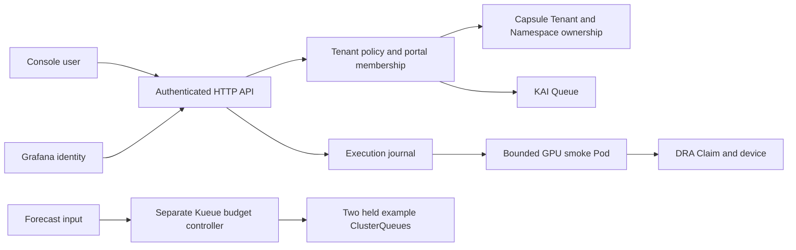

# Architecture

## Tenant path

`tenant_inventory.py` observes Capsule identities. `access.py` and `context.py` resolve the authenticated actor and tenant capabilities. `tenant_api.py` coordinates operations through the Kubernetes client; it does not treat a name or label alone as proof of ownership.

`namespaces.py` binds up to three namespaces to one tenant policy and queue. `admission.py` and `network_policy.py` generate guard resources. Their installation and CNI behavior must be validated in the target environment.

`executions.py` records request IDs, policy snapshots and Pod identity. The GPU workload is intentionally fixed and bounded. Observations distinguish completed execution, delete requests and verified resource-return states.

## Quota paths

The standalone simulator stores synthetic state in memory and advances a controlled clock. `quota_demo.py` exposes the same educational scenario inside the authenticated console.

The Kueue path uses explicitly bound tenant/CQ/LQ/Flavor identities and persistent ConfigMap state. It checks freshness, bounds, revision, cooldown and observation conditions before changing a held queue's nominal quota. The two-queue fixture is not a general cluster capacity allocator. The policy remains separate from existing KAI scheduling algorithms.

## Resource meaning

Device counts and host memory budgets do not combine GPUs into one contiguous memory space. Measured GPU free memory is not automatically reservable memory. A DRA Claim is an allocation request, not an isolation mechanism. No code here implements fractional runtime partitioning.
